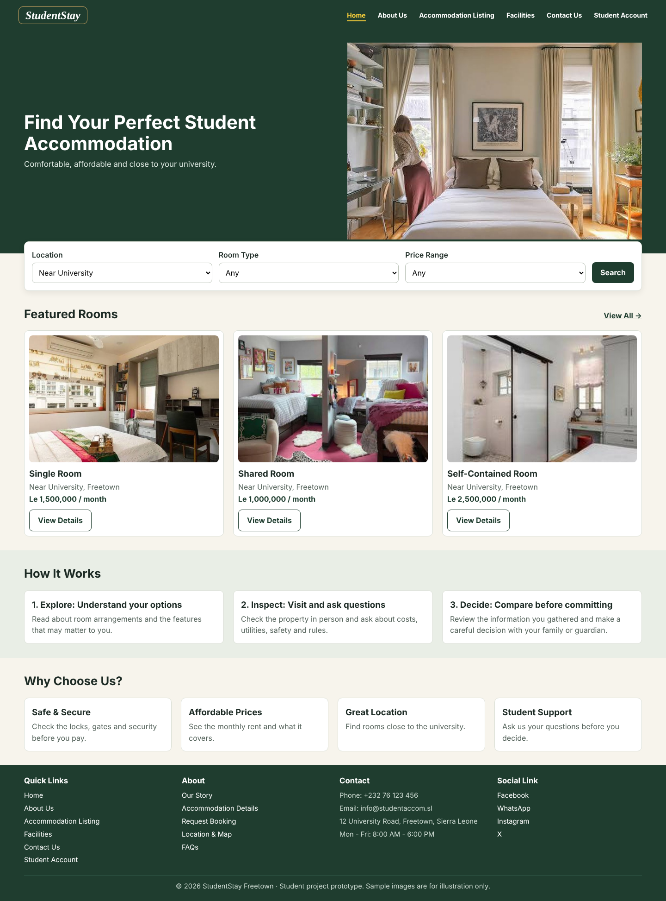
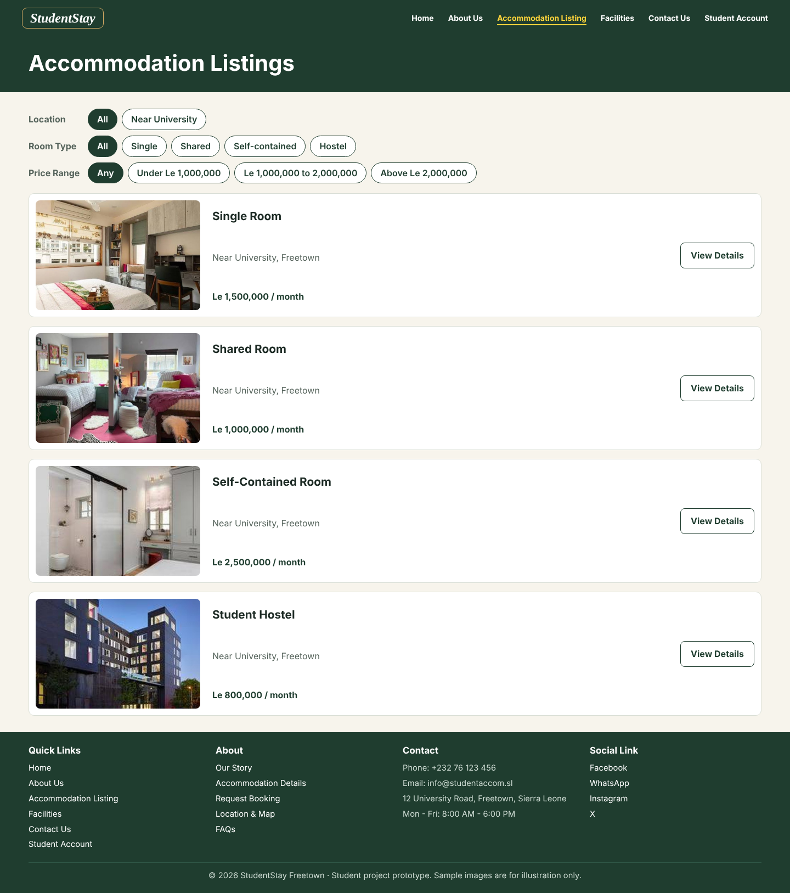
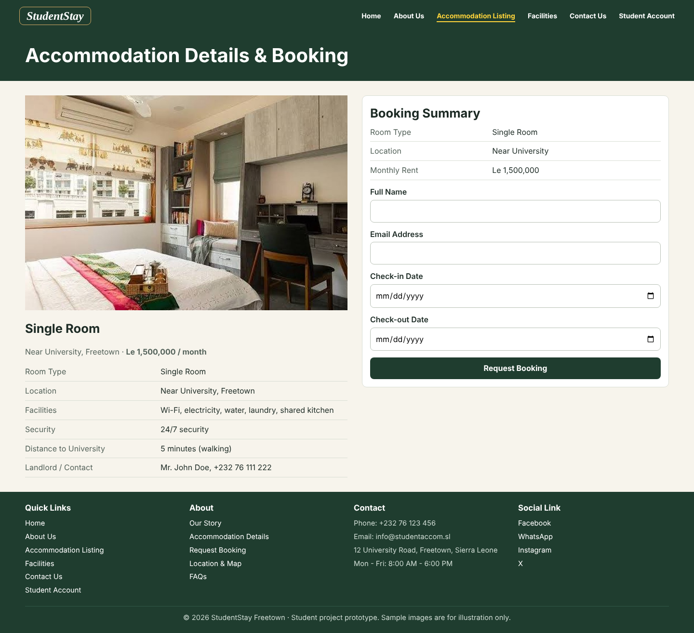
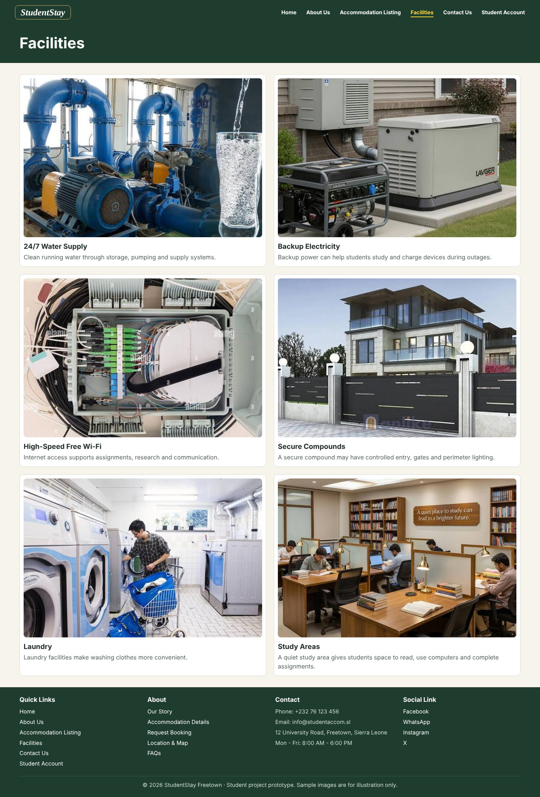
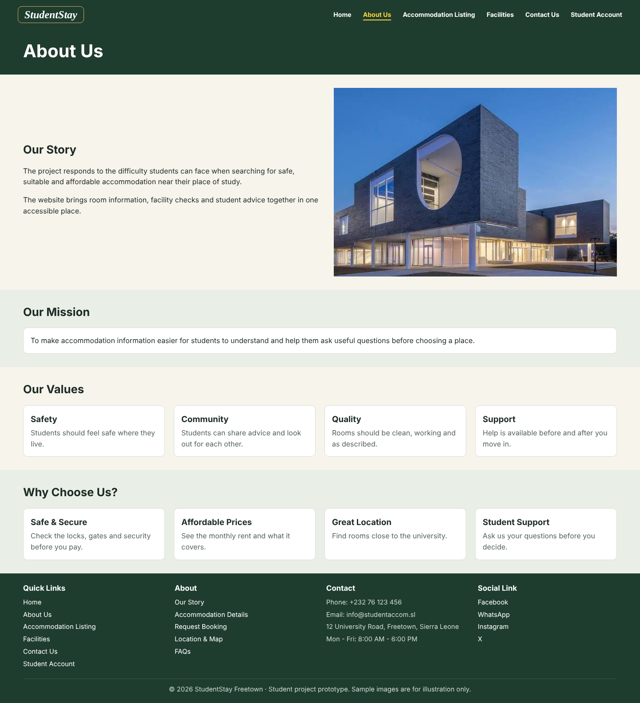
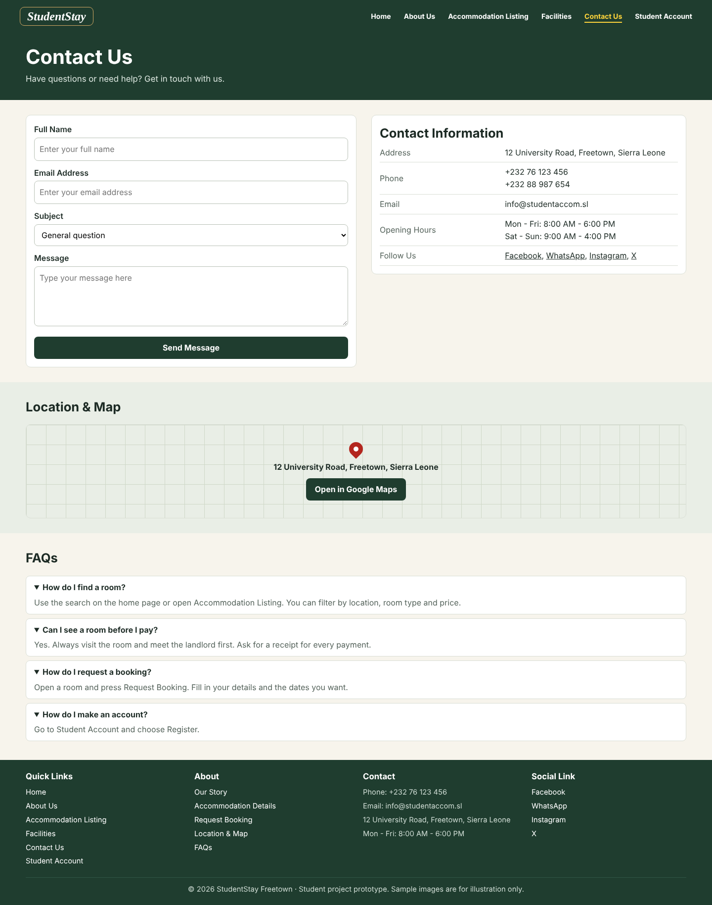
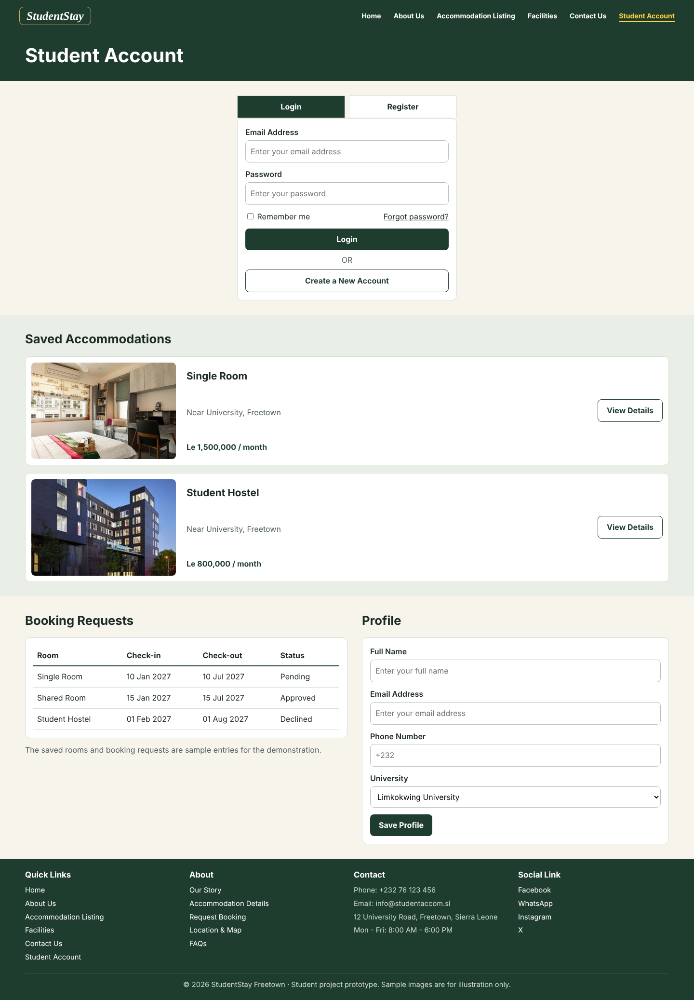
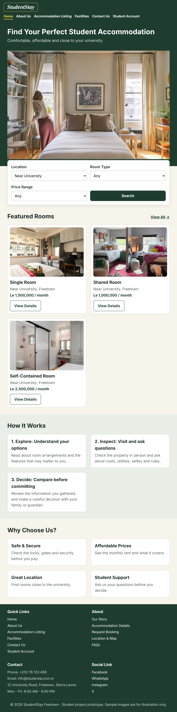
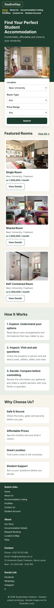

# StudentStay Freetown

StudentStay Freetown is a front-end website project designed to help students explore accommodation options in Freetown, Sierra Leone. It presents room categories, facilities, accommodation information, booking-request layouts, and contact information in one student-focused website.


- **Project type:** Static front-end website
- **Main technologies:** HTML5 and CSS3
- **JavaScript/frameworks:** No JavaScript framework or external front-end framework is used in this project.


## Table of Contents

1. [Project Overview](#project-overview)
2. [Project Objectives](#project-objectives)
3. [Website Pages and Screenshots](#website-pages-and-screenshots)
4. [How the Website Works](#how-the-website-works)
5. [Responsive Design](#responsive-design)
6. [Design and Accessibility Features](#design-and-accessibility-features)
7. [Folder Structure](#folder-structure)
8. [How to Run the Project](#how-to-run-the-project)
9. [Current Functionality and Limitations](#current-functionality-and-limitations)
10. [Possible Future Improvements](#possible-future-improvements)
11. [Author / Academic Submission](#author--academic-submission)

## Project Overview

Finding suitable accommodation is an important part of student life. StudentStay Freetown is a website concept that organizes accommodation information so that students can browse different room types, learn about facilities, review details, and find ways to contact the accommodation provider.


The website uses a consistent visual style across its pages. A dark-green theme, warm neutral page background, gold highlights, cards, buttons, and photographs help create a clear and recognizable appearance.


## Project Objectives

- Provide a simple online place for students to explore accommodation options.
- Display different room categories, including single rooms, shared rooms, self-contained rooms, and student hostels.
- Present facilities such as water supply, backup electricity, Wi-Fi, laundry, secure compounds, and study areas.
- Make important information accessible through clear navigation.
- Provide page layouts for booking requests, student account access, and contacting the accommodation provider.
- Apply responsive CSS so the layout can adapt to desktop, tablet, and mobile screen widths.


## Website Pages and Screenshots

### 1. Home Page (`index.html`)

The home page introduces the StudentStay accommodation service. It includes a hero section, featured accommodation cards, a search form for location, room type and price range, a “How It Works” section, and information explaining why students may choose the service. It also provides navigation links to other pages and accommodation details.




*Figure 1: Home page preview.*


### 2. Accommodation Listing Page (`accommodation.html`)

The accommodation listing page displays the available example room categories, including single rooms, shared rooms, self-contained rooms, and student hostels. Each listing includes an image, accommodation type, location information, price, and a button to view details. CSS-based filter controls are provided for location, room type, and price range.




*Figure 2: Accommodation listing page preview.*


### 3. Accommodation Details and Booking Page (`details.html`)

This page displays more information about an example accommodation, including its photo, room type, location, monthly rent, facilities, security information, and distance from the university. A booking-request form allows a visitor to enter their name, email address, and check-in and check-out dates and prepare a booking request.




*Figure 3: Accommodation details and booking page preview.*


### 4. Facilities Page (`facilities.html`)

The facilities page presents the services and amenities that students may need while staying in accommodation. The page includes photographs and descriptions of 24/7 water supply, backup electricity, high-speed Wi-Fi, secure compounds, laundry facilities, and study areas.




*Figure 4: Facilities page preview.*


### 5. About Us Page (`about.html`)

The About Us page explains the StudentStay concept, its story, mission, and values. It describes the aim of helping students find safe, suitable, and affordable accommodation, and includes sections about safety, community, quality, and support, along with reasons to choose the service.




*Figure 5: About Us page preview.*


### 6. Contact Page (`contact.html`)

The Contact page provides a form for visitors to enter their name, email address, subject, and message. It also displays contact details, opening hours, a location/map section with a Google Maps link, and expandable Frequently Asked Questions (FAQs) to help visitors find answers to common questions.




*Figure 6: Contact page preview.*


### 7. Student Account Page (`account.html`)

The Student Account page provides a front-end account interface with Login and Register tabs. It also displays example saved accommodations, booking-request information, and a profile form containing fields such as full name, email address, phone number, and university. These features are interface examples and are not connected to a live account or database system.




*Figure 7: Student account page preview.*


## How the Website Works

### 1. Navigation between pages

The header navigation appears throughout the website. Each navigation link points to a local HTML file, allowing visitors to move between Home, About Us, Accommodation, Facilities, Contact Us, and Student Account. The footer also provides links to key pages.


### 2. Exploring accommodation

The home page introduces the accommodation service and highlights example rooms. Visitors can follow links to the accommodation listing page or open the details page from a room card. The accommodation page displays room listings with images and summary information. Its filter controls are implemented using HTML radio inputs and CSS selectors. Selecting a filter changes which listing cards are displayed; this interaction does not require JavaScript.


### 3. Viewing accommodation details and requesting a booking

The details page presents an example room and a booking-request form. The form asks for basic details such as a student’s name, email address, check-in date, and check-out date. In this version, the form uses a `mailto:` action to prepare a message through the visitor’s configured email application. It is not connected to a server-side booking system or a live availability database.


### 4. Using the student account page

The account page uses radio inputs and CSS to switch between the Login and Register panels. It also includes example saved-accommodation content, booking-request information, and a profile form. These are front-end interface examples; account registration, login, saving data, and profile updates are not stored in a database in this version.


### 5. Contacting the provider

The contact page includes a contact form configured with a `mailto:` action. When submitted, the browser may open the user’s email application with the form information prepared. The page also includes a location section with a link to a Google Maps search and expandable FAQ items using the HTML `details` and `summary` elements.


### 6. Search form on the home page

The home page contains a search form with selection fields for location, accommodation type, and price. It submits the selected values to `accommodation.html` using the GET method. The current project provides the search interface and navigation flow; it does not include a database-backed search engine that processes and filters results based on those query values.


## Responsive Design

The website is built with responsive layout rules in `css/style.css`. Each HTML page includes a viewport meta tag so the browser can size the page appropriately on mobile devices.


The stylesheet uses CSS Grid, flexible containers, relative sizing, and media queries to adjust the layout at different screen widths.


### Desktop layout

On wider screens:

- The header places the logo and navigation in a horizontal layout.
- Content sections can use two-column layouts.
- Accommodation and feature cards can appear in multi-column grids.
- The home-page search form uses multiple columns.
- Accommodation listing cards can display the image, description, and action side by side.


*Figure 8: Desktop layout preview.*


### Tablet layout

At widths of **860 pixels and below**, the stylesheet:

- Changes split two-column sections into one column.
- Reduces three- and four-column card grids to two columns.
- Changes the search form to two columns.
- Stacks the content inside accommodation listing rows.
- Reduces header padding and adjusts navigation spacing.



*Figure 9: Tablet layout preview.*


### Mobile layout

At widths of **520 pixels and below**, the stylesheet:

- Changes two-, three-, and four-column grids to a single column.
- Changes the search form to a single-column layout.
- Allows cards and form fields to use the available screen width.
- Keeps the page content readable without requiring a wide desktop screen.



*Figure 10: Mobile layout preview.*


These breakpoints are implemented with CSS media queries. The responsive behavior should be checked in a browser at desktop, tablet, and phone widths.


## Design and Accessibility Features

- **Consistent colour palette:** CSS custom properties define the main green, gold, background, text, and border colours.
- **Reusable layout styles:** Shared classes such as `.w`, `.grid`, `.card`, `.box`, `.btn`, and `.split` help keep the pages visually consistent.
- **Responsive images:** Images are constrained to the width of their containers and use `object-fit: cover` in cards.
- **Visible keyboard focus:** Links, buttons, and form controls receive a visible outline when focused with the keyboard.
- **Semantic HTML:** The pages use structural elements such as `header`, `nav`, `main`, `section`, and `footer`, along with headings and form labels.
- **Expandable FAQs:** Native HTML disclosure elements allow users to open and close FAQ answers.
- **CSS-only interface controls:** Accommodation filters and account tabs use HTML radio inputs with CSS selectors.


## Folder Structure

```text
StudentStay/
├── README.md
├── screenshots/
│   ├── 01-Homepage-Desktop.png
│   ├── 02-Homepage-Mobile.png
│   ├── 03-Homepage-Tablet.png
│   ├── 04-Accommodation-Page.png
│   ├── 05-Accommodation-Details.png
│   ├── 06-Facilities-Page.png
│   ├── 07-About-Us-Page.png
│   ├── 08-Contact-Page.png
│   └── 09-Student-Account-Page.png
└── site/
    ├── index.html
    ├── about.html
    ├── accommodation.html
    ├── details.html
    ├── facilities.html
    ├── contact.html
    ├── account.html
    ├── css/
    │   └── style.css
    └── images/
        ├── hero.jpg
        ├── campus.jpg
        ├── single.jpg
        ├── shared.jpg
        ├── selfc.jpg
        ├── hostel.jpg
        ├── water.jpg
        ├── power.jpg
        ├── wifi.jpg
        ├── compound.jpg
        ├── laundry.jpg
        └── study.jpg
```


## How to Run the Project

This is a static HTML and CSS website, so no package installation or build process is required.


1. Download or clone this repository.
2. Open the project folder.
3. Open the `site` folder.
4. Double-click `index.html` to open the home page in a web browser.


For a local development server, open the project folder in Visual Studio Code and use the Live Server extension if it is installed. Open `site/index.html` through Live Server.


**Important:** Keep the `css` and `images` folders in their existing locations relative to the HTML files. The pages use relative file paths, so moving or renaming these folders may cause stylesheets or images not to load.


## Current Functionality and Limitations

This submission is a front-end website prototype. It demonstrates page structure, styling, navigation, responsive layouts, and selected browser-side interactions.


The following functions are interface demonstrations and are not connected to a back-end service in this version:

- Real student registration and authentication.
- Database storage for user profiles or saved accommodation.
- Persistent booking records or live room availability.
- Online payment processing.
- Server-side search or filtering based on the home-page search fields.
- Automatic delivery of contact or booking messages through a website server.


The contact and booking forms use `mailto:` links, which depend on the visitor having a configured email application. The account forms do not create real accounts or save submitted information.


## Possible Future Improvements

- Add a back-end application and database to manage rooms, users, and bookings.
- Implement secure registration, login, and password management.
- Store saved rooms and profile information for each student.
- Add real search, sorting, and filtering based on accommodation data.
- Add booking confirmation and room availability checks.
- Connect contact and booking forms to a reliable email or server-side submission service.
- Test the website on more devices and browsers and improve accessibility based on testing.


## Author / Academic Submission

- **Student Name:** Alfred Ndanema
- **Course:** BIT1102
- **Module:** DCOMP204: WEB DESIGN 1
- **Project:** StudentStay Freetown
- **Assignment:** Assignment 2
- **Description:** Student accommodation website front-end project for Freetown, Sierra Leone.
